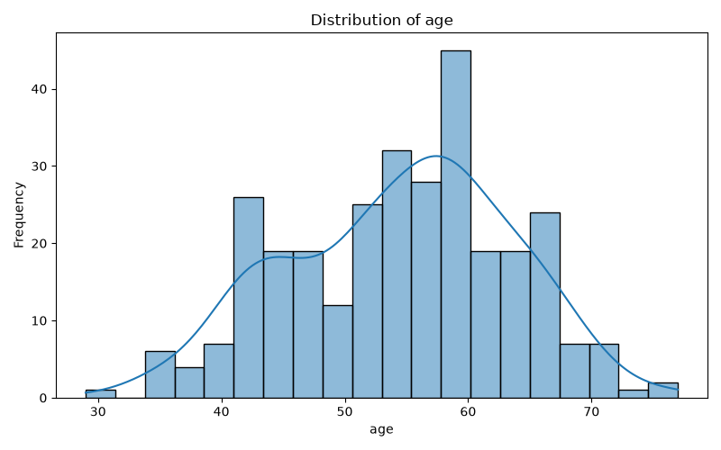
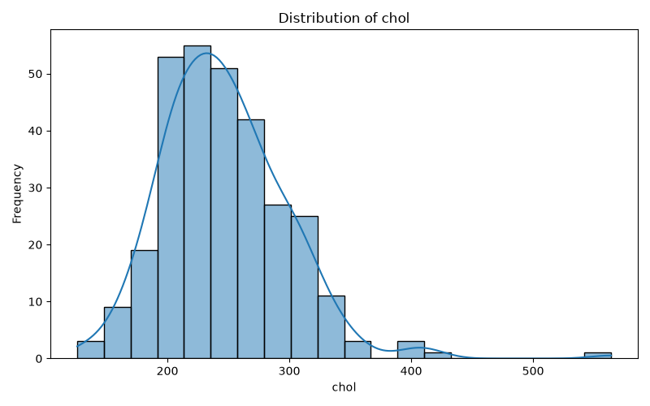
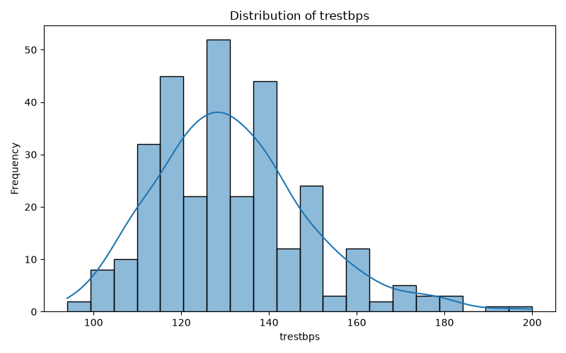
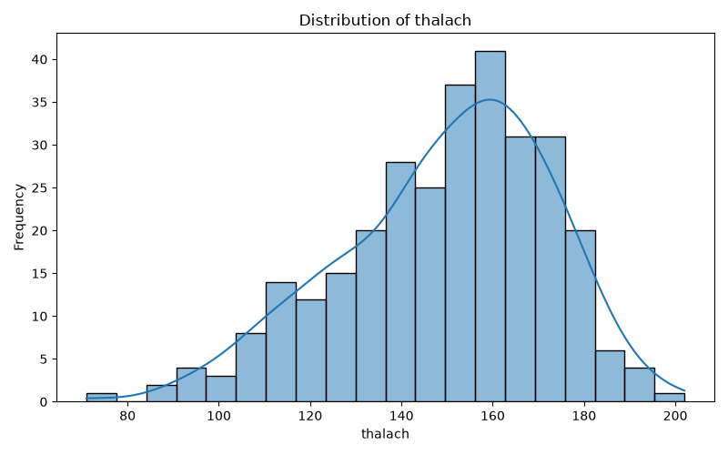

# CSPC — Computer Science for Physics and Chemistry

My coursework repository for the course. Each practical lives under `PW<n>/Lab <X>/`.

## Setup

Create and activate the environment for a given lab:

conda env create -f "PW<n>/Lab <X>/environment.yml"
conda activate cspc

Run the tests for a lab from inside its folder:
cd "PW<n>/Lab <X>"
pytest -v

---

## PW1 — Lab A: Reproducible Foundations

**What I built:**

- A radioactive decay simulation (pure-Python loop and NumPy vectorised versions), a test suite verifying its behavior, and a speed comparison between the two implementations.

**Speed comparison (loop vs NumPy):**

| version | time (s) |
|---------|----------|
| pure-Python loop | 3.9674 |
| NumPy (vectorised) | 0.0004 |

- Speed-up: **10424.03× in this run**

**Tests:** 3/3 passing

**Conclusion:**

- The NumPy implementation is much faster than the pure-Python loop because it processes all atoms at once with vectorized operations instead of looping over each one individually in Python. Working through this lab reinforced how much overhead per-element Python loops add compared to array-based NumPy operations.

## PW1 — Lab B: Data, Plotting, and Automation

**What I built:**

* Read the observed radioactive decay data from `decay_observed.csv`.
* Compared the observed data with the analytical exponential decay law using `N0` equal to the first observed value and `λ = 0.3`.
* Created a 1×2 figure with shared x and y axes:

  * Left: scatter plot of the observed data.
  * Right: analytical exponential decay curve.
* Saved the generated figure as `figure.png`.

**Snakemake automation:**

* Created a `Snakefile` that uses `decay_observed.csv` as input and `figure.png` as output.
* Snakemake runs `plot.py` automatically when `figure.png` is missing or needs to be regenerated.
* When the output is already up to date, Snakemake correctly reports that nothing needs to be done.

**Conclusion:**

* The observed data shows the expected decreasing decay behavior, while the analytical model provides a smooth exponential curve for comparison.
* Snakemake makes the plotting workflow reproducible by automatically generating the figure from the input data.

## PW2 — Lab A: Motion from Tracking Data

**What I built:**

* Loaded noisy free-fall position measurements from `freefall.csv`.
* Used `np.gradient` to calculate velocity from position and acceleration from velocity.
* Mean acceleration: **-8.5797 m/s²**.
* Acceleration standard deviation: **28.7161 m/s²**.
* Integrated the noisy acceleration to recover velocity and then position.
* The largest difference between the recovered position and the original position was **0.7846 m**, which is within the expected 1 m range.
* Created `motion.png` containing position, velocity, and acceleration versus time, with the true `-9.81 m/s²` acceleration marked on the acceleration plot.

**Why is acceleration noisy?**

The original position measurements contain measurement noise. Differentiation amplifies this noise, and taking the derivative twice makes the acceleration much noisier than the original position data. This is why the acceleration has a large standard deviation even though the position data looks relatively smooth.

**What happened when integrating back?**

Integrating the noisy acceleration back to velocity and then position reduces the effect of the random high-frequency noise. The recovered position was close to the original measurements, with a maximum difference of only **0.7846 m**.

**Conclusion:**

This lab demonstrates that numerical differentiation is very sensitive to measurement noise, while integration can recover a smooth quantity from noisy derivative data.

### PW2 — Lab A Bonus: 2D Trajectory

**What I built:**

* Loaded the 2D tracking data from `trajectory.csv`, containing time, x-position, and y-position.
* Plotted the object's trajectory by plotting `x` against `y`.
* Used `np.gradient` to calculate the velocity components:
  * `vx = dx/dt`
  * `vy = dy/dt`
* Calculated the speed using `sqrt(vx² + vy²)`.
* Created `trajectory.png` showing the object's path.
* Created `speed.png` showing speed versus time.

**Results:**

* Minimum speed: **7.6690 m/s**
* Maximum speed: **38.6930 m/s**

**Conclusion:**

The trajectory data shows a looping, butterfly-shaped path. The speed changes over time as the object's motion changes along the x and y directions.

## PW2 — Lab B: Optimization in Chemistry

This lab explored how numerical optimization and root-finding methods can be used to solve practical problems in chemistry.

### Part 2 — Optimization Warm-up

I compared three approaches:

* Gradient descent
* Newton's method
* SLSQP

#### Easy function

For `f(x) = (x - 3)² + 1`, all three methods found the same minimum:

| Method           |     Result |
| ---------------- | ---------: |
| Gradient descent | x ≈ 3.0000 |
| Newton           | x = 3.0000 |
| SLSQP            | x = 3.0000 |

This function is convex and has one clear minimum, so all three methods converge to the same solution.

#### Harder function

For `g(x) = x⁴ - 3x² + x + 5`, the behavior was more interesting because the function has several stationary points.

| Starting point | Method           |      Result | Type        |
| -------------- | ---------------- | ----------: | ----------- |
| x₀ = 0         | Gradient descent | x ≈ -1.3008 | Minimum     |
| x₀ = 0         | Newton           |  x ≈ 0.1699 | **Maximum** |
| x₀ = 0         | SLSQP            | x ≈ -1.3009 | Minimum     |
| x₀ = 2         | Gradient descent | x ≈ -1.3008 | Minimum     |
| x₀ = 2         | Newton           |  x ≈ 1.1309 | Minimum     |
| x₀ = 2         | SLSQP            | x ≈ -1.3006 | Minimum     |

The important result is that **Newton's method finds a stationary point, not necessarily a minimum**. Its result also depends on the starting point.

For `x₀ = 0`, Newton converged to `x ≈ 0.1699`, where the second derivative is negative, so this point is a maximum.

For `x₀ = 2`, Newton converged to `x ≈ 1.1309`, where the second derivative is positive, so this point is a minimum.

### Part 3 — Reaction-Rate Fitting

The goal was to estimate the rate constant of a first-order reaction from measured concentration data.

The reaction model was:

`C(t) = C₀ exp(-kt)`

I:

* Loaded the experimental data from `kinetics.csv`.
* Used the first measured concentration as `C₀`.
* Defined the sum of squared errors between the measured and predicted concentrations.
* Used SLSQP to find the value of `k` that minimized this error.
* Plotted the measured data together with the fitted reaction curve.

The fitted rate constant was:

**k = 0.26176**

The resulting plot was saved as `kinetics.png`.

### Part 4 — Chemical Equilibrium

I studied the reaction:

`H₂ + I₂ ⇌ 2HI`

with an equilibrium constant of:

**K = 15.6**

The equilibrium extent was calculated in two different ways:

1. Newton root-finding
2. SLSQP minimization

| Method | Equilibrium extent |
| ------ | -----------------: |
| Newton |          0.6638477 |
| SLSQP  |          0.6638474 |

The difference between the two results was only **2.39 × 10⁻⁷**, showing that the two methods agree very closely.

#### Equilibrium composition

At equilibrium:

| Substance |      Amount |
| --------- | ----------: |
| H₂        | 0.33615 mol |
| I₂        | 0.33615 mol |
| HI        | 1.32770 mol |

The equilibrium composition plot was saved as `equilibrium.png`.

### Part 5 — Titration Bonus

For the titration problem, I determined the equivalence point from the pH curve.

I:

* Loaded the data from `titration.csv`.
* Calculated the slope of the pH curve using `np.gradient(pH, V)`.
* Used `np.argmax(slope)` to find the point where the pH was changing most rapidly.
* Plotted both the titration curve and its slope.

The equivalence point was found at:

**50.0 units of base volume**

The final figure was saved as `titration.png`.

### Conclusion

This lab showed how numerical methods can be applied to several practical chemistry problems.

The optimization warm-up demonstrated an important difference between methods: **Newton's method finds stationary points and can therefore converge to a maximum, while SLSQP and gradient descent can be used to minimize an objective function.**

The kinetics problem showed how optimization can estimate a reaction parameter from experimental data. The equilibrium problem demonstrated that root-finding and minimization can produce essentially identical results. Finally, the titration bonus showed how numerical differentiation can be used to identify an equivalence point from experimental measurements.

## PW3 — Session 1: Statistical Analysis of the Heart Disease Dataset

**What I built:**

* Loaded the heart disease dataset from `heart.csv` using pandas.
* Inspected the dataset dimensions, first five rows, and summary statistics.
* Selected four numerical variables for distribution analysis:
  * `age`: Age of the patients.
  * `chol`: Serum cholesterol.
  * `trestbps`: Resting blood pressure.
  * `thalach`: Maximum heart rate achieved.
* Created histograms with KDE curves using Seaborn to visualize the distributions.
* Created boxplots to examine medians, spread, and potential outliers.
* Created Q-Q plots to compare the observed distributions with a theoretical normal distribution.
* Saved the generated figures in the `PW3` directory.

**Dataset:**

The dataset contains **303 observations and 14 columns**.

**Distribution and normality analysis:**

| Variable | Histogram observation | Boxplot observation | Q-Q plot observation | Shapiro–Wilk result | Final conclusion |
| :--- | :--- | :--- | :--- | :--- | :--- |
| `age` | Approximately symmetrical and roughly bell-shaped, with a possible secondary peak around 58–60. | Median around 56, relatively balanced spread, and no obvious outliers. | Most points follow the reference line, with minor deviations at the extremes. | $W = 0.9865$, $p = 0.00607$ | Visually approximately normal, though rejected by Shapiro–Wilk due to mild tail deviation. |
| `chol` | Right-skewed, with a peak around 220–240 and a long upper tail extending beyond 500. | Median around 240, asymmetric upper spread, and several high outliers. | The upper tail departs substantially from the reference line. | $W = 0.9473$, $p = 0.00000$ | Non-normal (right-skewed with a heavy upper tail). |
| `trestbps` | Broad distribution centered around 130–135, with slight right skewness and an upper tail extending toward 200. | Median around 130, interquartile range approximately 120–140, and several high outliers. | Points follow the reference line reasonably well in the middle but deviate in the tails. | $W = 0.9665$, $p = 0.00000$ | Non-normal (broadly bell-shaped but right-skewed with high outliers). |
| `thalach` | Unimodal distribution with a peak around 160 and a longer lower-value tail. | Median around 153, asymmetric spread, and a potential low outlier around 71. | Points follow the line reasonably well in the middle but deviate at the lower tail. | $W = 0.9765$, $p = 0.00007$ | Non-normal (negatively skewed with lower tail departure). |

### Why were these plots and statistical tests used?

* **Histograms** show the overall shape of each distribution and help reveal skewness.
* **Boxplots** summarize the median and interquartile range and highlight potential outliers.
* **Q-Q plots** compare the observed quantiles with those expected under a normal distribution. Systematic departures from the reference line indicate possible non-normality.
* **Shapiro–Wilk test** provides a formal statistical hypothesis test for normality ($H_0$: data is normally distributed).

Using visual plots together with formal testing provides a complete understanding of the distributions.

**Conclusion:**

This session introduced exploratory data analysis and graphical methods for investigating distributions.

The four variables exhibit different distributional characteristics. `age` appears approximately normal based on visual inspection, while `chol` shows clear right skewness and a heavy upper tail. `trestbps` is broadly bell-shaped but has tail deviations and high outliers. `thalach` shows negative skewness and a departure from normality in its lower tail.

These observations demonstrate why distributions should be examined before applying statistical methods that rely on normality assumptions. The conclusions are based on graphical inspection rather than formal statistical tests.

The formal **Shapiro–Wilk test** rejected the null hypothesis of normality ($p < 0.05$) for all four variables. This highlights the distinction between statistical significance and practical visual normality in larger sample sizes ($N = 303$), demonstrating why distributions should be thoroughly examined before applying statistical methods that rely on normality assumptions.